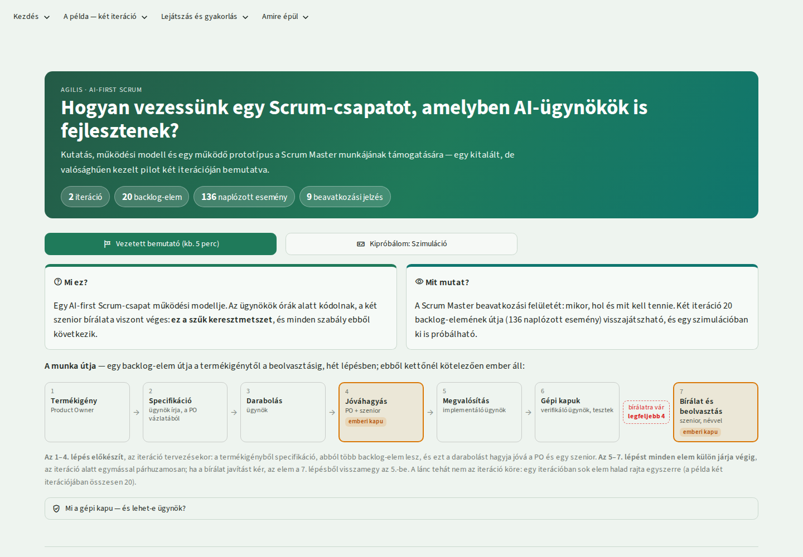
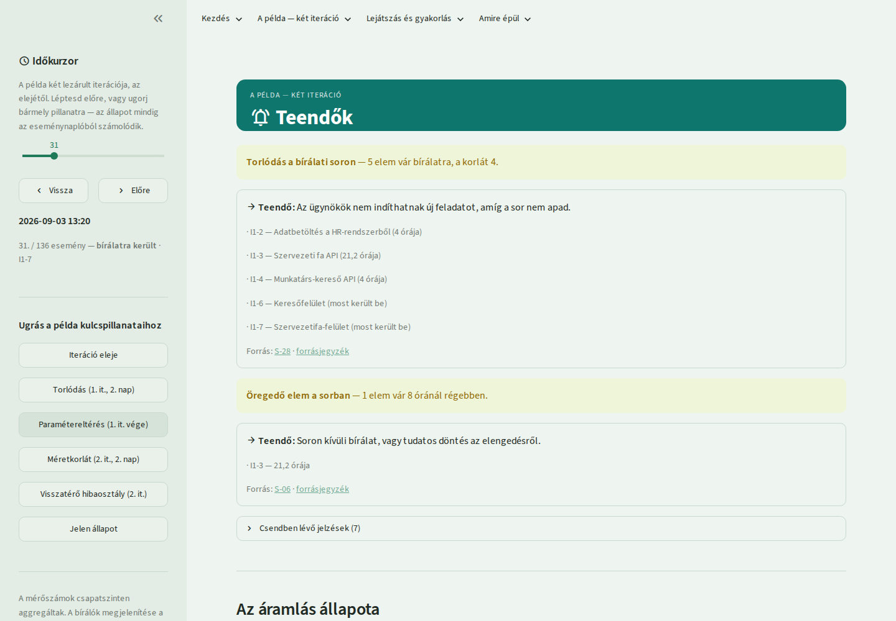
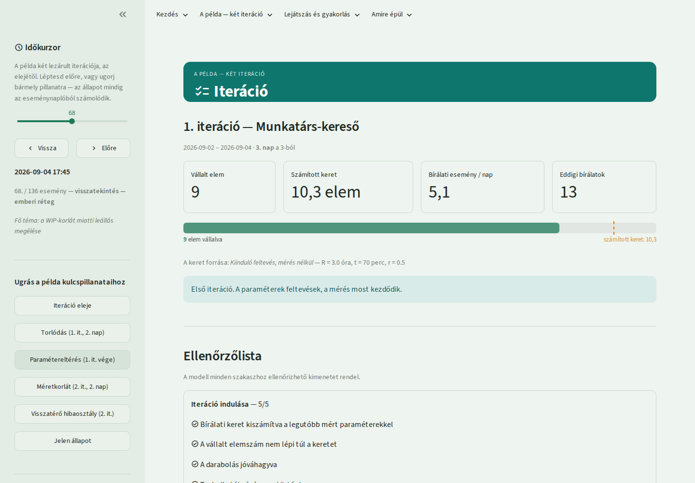
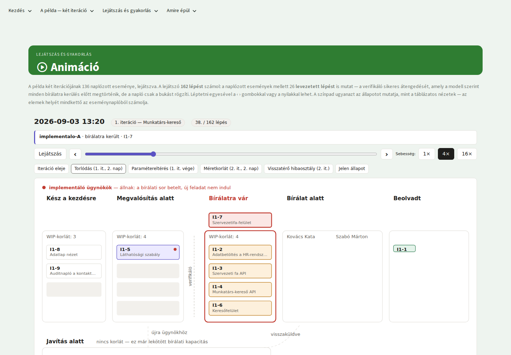
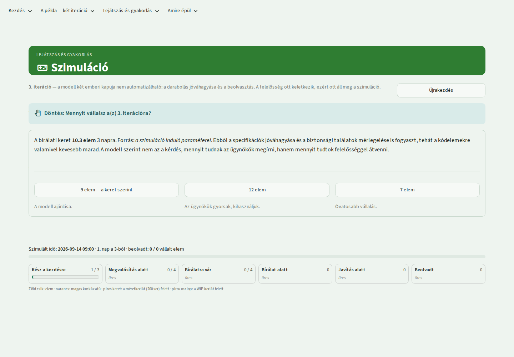
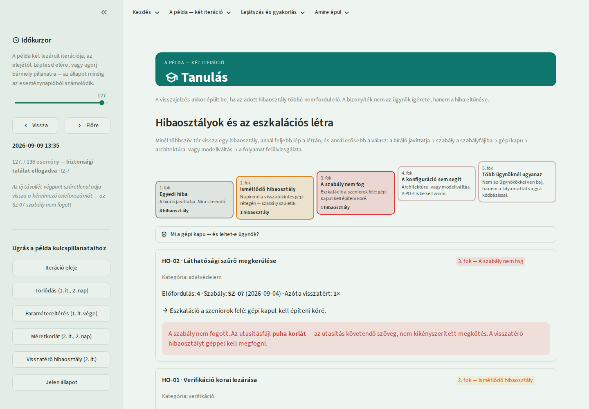
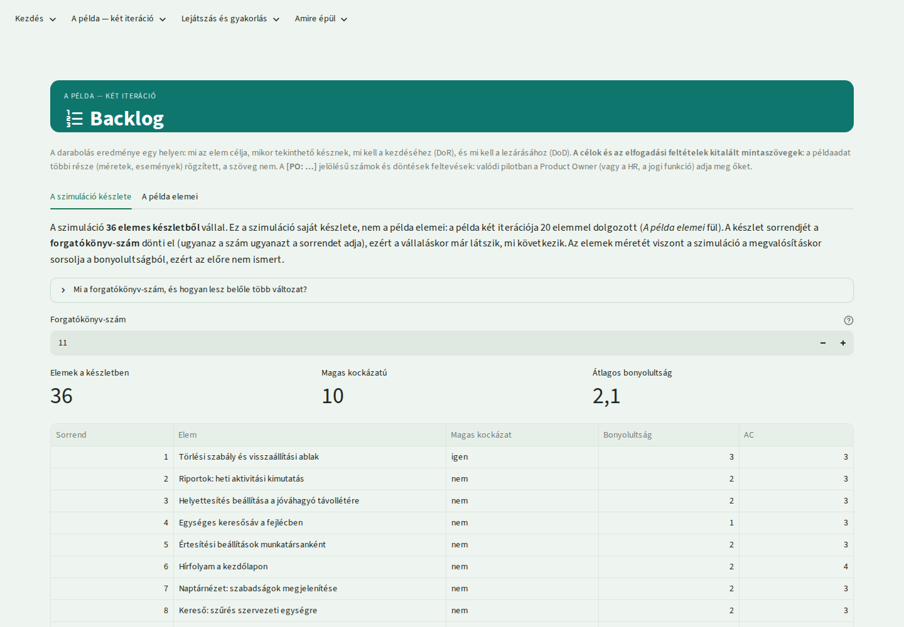

# AI-first Scrum — működési modell és SM-támogató prototípus

Egy általam összeállított **kutatás, működési modell és működő prototípus** arról, hogyan lehet egy olyan
Scrum-csapatot vezetni, amelyben a fejlesztők mellett **AI-ügynökök** is dolgoznak. A kiindulás egy kitalált, de
valósághűen kezelt pilot: egy közepes magyar vállalat AI-first Scrum-csapatot próbál ki egy intranet-termék
fejlesztésére.

A modell fő állítása, amelyet a kutatás is alátámaszt: **az ügynökök nem a kódírásban, hanem az emberi bírálatban
érik el a határt.** A csapat kapacitását ezért nem az ügynökök sebessége adja, hanem az, hogy a szeniorok mennyi
munkát tudnak *felelősséggel* átvenni — és minden más szabály (bírálati keret, WIP-korlát, méretkorlát,
eszkalációs létra) ebből vezethető le.

> **English summary.** *A research-backed operating model and a working prototype for a Scrum team in which AI
> agents work alongside developers. The central finding: agents are limited not by how fast they write code but
> by how much work senior engineers can take responsibility for, so the model derives a review-capacity budget,
> WIP and size limits and an escalation ladder from that single constraint. The repository contains a
> research set of 12 documents with a graded source list (36 sources), a ten-document concept, templates, and a
> Streamlit app with 13 views: a Scrum Master intervention interface fed with a worked two-iteration example
> (136 logged events), an animation, and a simulation in which you make the same decisions yourself. Built with
> Python and Streamlit; the simulated agent is deterministic and calls no external model.*

## Mit találsz itt?

| Réteg | Tartalom |
|---|---|
| [`kutatas/`](kutatas/) | 11 tematikus dokumentum és összefoglaló az empirikus adatokról, a bírálatról, a biztonságról, a tesztelésről, a mérésről és a jogi keretről; **36 forrás** megbízhatósági szintezéssel; szószedet |
| [`koncepcio/`](koncepcio/) | a működési modell tíz dokumentumban (a munka útjától a kockázatokig), a **két iteráció** végigvezetve, az SM-támogató felület specifikációja, 4 használatra kész sablon |
| [`prototipus/`](prototipus/) | a Streamlit-alkalmazás: 13 nézet, a példa **136 naplózott eseményével**, animáció, szimuláció |
| [`spike/`](spike/) | egy mellékszál: az ügynök-architektúra összehasonlítása friss, célzott kutatással |
| [`sm-all.md`](sm-all.md) | az eredeti brief |
| [`docs/adr/`](docs/adr/) | öt tervezési döntés (animáció, determinisztikus ügynök, iterációlánc, típusos döntési tények, arculat) |

## Képernyőképek

*A nyitóoldal: a kérdés, a számok és a munka útja hét lépésben — ebből kettőnél kötelezően ember áll.*

| | |
|---|---|
|  |  |
| **Teendők:** a felület nem irányítópult, hanem azt mondja meg, mit kell most tenni — itt a torlódás a bírálati soron. | **Iteráció:** a vállalás a számított bírálati kerethez képest, ellenőrzőlistával. |
|  |  |
| **Animáció:** a 136 esemény lejátszva; látszik, hogyan torlódik a sor, és hogyan állnak le az ügynökök. | **Szimuláció:** egy harmadik iteráció, amelyben te hozod ugyanazokat a döntéseket. |
|  |  |
| **Tanulás:** hibaosztályok és az eszkalációs létra — a bizonyíték nem az ügynök ígérete, hanem a hiba eltűnése. | **Backlog:** a darabolás elemenként, céllal, elfogadási feltételekkel, DoR/DoD-feltételekkel. |

## A modell három tétele

- **A bírálati keret számolható.** A vállalás a szeniorok bírálati idejéből jön, nem az ügynökök sebességéből; a
  paraméterek (`R`, `t`, `r`) induláskor feltevések, és a felület kimondja, hogy **bizonyíték nélküli saját
  tervezési döntések**. Az első iteráció után a keret már a *mért* értékekből számol.
- **Mennyiséget korlátozunk, nem a bírálót gyorsítjuk.** WIP-korlát a bírálatra váró soron, méretkorlát a
  csomagokon; túllépésnél a teendő az ügynökök leállítása, illetve a visszabontás — nem hosszabb bírálat.
- **A tanulás hibaosztályon mérhető.** Ismétlődő hibára szabály, majd gépi kapu, végül architektúra- vagy
  modellváltás következik (eszkalációs létra); a bizonyíték az, hogy az adott hibaosztály **eltűnik**.

## Hogyan használható?

- **Kívülről érkezőként:** a *Vezetett bemutató* (kb. 5 perc) hat fejezetben vezet végig a modellen.
- **Gyakorlóként:** a *Szimuláció* nézetben ugyanazokat a döntéseket hozod meg, majd a mérleg szembesít —
  a tanulság az, hogy a **felületes bírálat szebb mérőszámokat termel**, miközben több hiba csúszik át.
- **Olvasóként:** a kutatás összefoglalója, majd a koncepció 00. és 07. dokumentuma; a háttéranyag a felületen
  közvetlenül is olvasható (*Amire épül* menücsoport).
- **Önálló fájlként:** az animáció szerver nélkül megnyitható HTML-be is kiírható:
  `.venv/bin/python prototipus/eszkozok/animacio_export.py animacio.html`.

## Korlátok, amelyeket kimondok

- A pilot és a csapat **kitalált**; a mintaadat a modell működését mutatja, nem valódi mérést.
- A szimuláció **a modell feltevéseivel számol, nem a valósággal**; az ügynök determinisztikus és nem hív külső
  modellt.
- A kutatás szerint az AI-ügynökös csapat gyakorlata létezik, de **a keretrendszere nincs kidolgozva** — ez a
  modell ennek egy javaslata, nem bevált módszer.

## Minőségbiztosítás

363 automatizált teszt fedi le a bírálati keret számítását, a beavatkozási jelzések logikáját, az animáció
forgatókönyvét, a szimulációs motort, az iterációláncot és a felület szakszavait. A jelzéslogika hibátlan lehet úgy
is, hogy a színpadon semmi sem látszik, ezért a képernyőképeket böngészőben is megnéztem
(`prototipus/eszkozok/kepernyokepek.py`, `showcase_kepek.py`).

## Hogyan készült?

A kutatást, a koncepciót és a prototípust AI-asszisztenssel (Claude) közös munkában állítottam össze, rövid
iterációkban; a döntéseket én hagytam jóvá. A kutatásba csak megnyitott forrás kerülhetett, megbízhatósági
szinttel jelölve.

## Indítás és tesztek

    python3 -m venv .venv
    .venv/bin/pip install -r prototipus/requirements-dev.txt
    .venv/bin/python -m streamlit run prototipus/streamlit_app.py
    .venv/bin/python -m pytest prototipus

A képernyőképekhez és az animáció képeihez egyszer: `.venv/bin/playwright install chromium`, majd
`.venv/bin/python prototipus/eszkozok/showcase_kepek.py`.

## Licenc

- A **kód** (`prototipus/`): [MIT](LICENSE).
- A **tartalom** (`kutatas/`, `koncepcio/`, `spike/`, `sm-all.md`, `docs/`, a képernyőképek):
  [CC BY 4.0](LICENSE-CONTENT.md) — szabadon felhasználható és átdolgozható, a forrás megjelölésével.

A pilot, a vállalat és a csapat kitaláltak.
